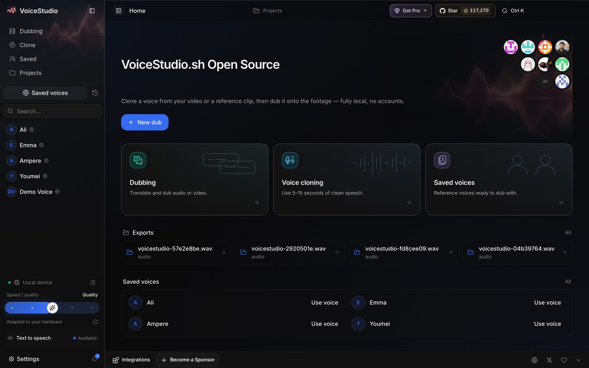
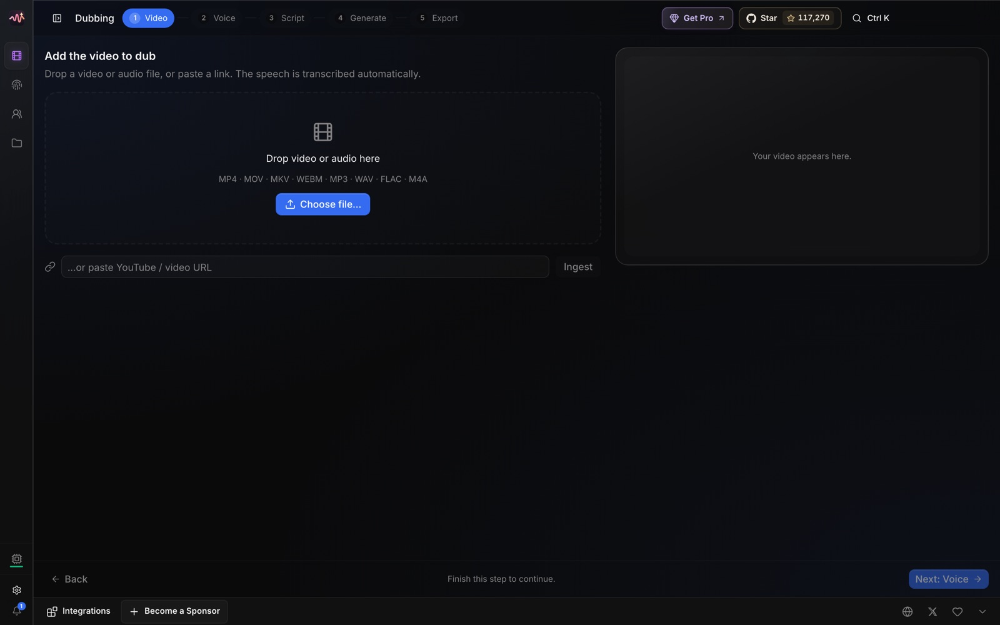
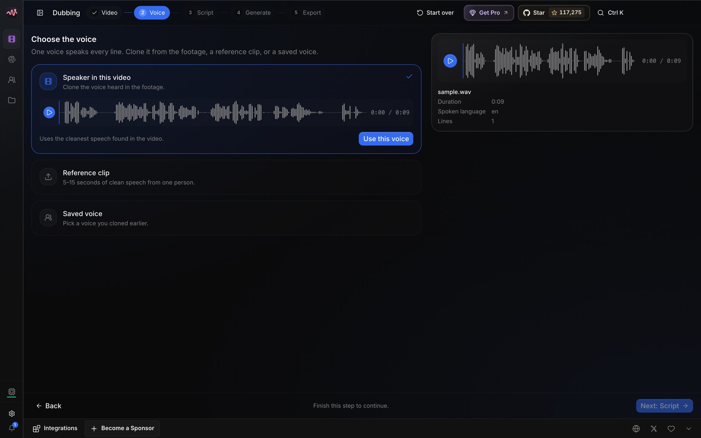
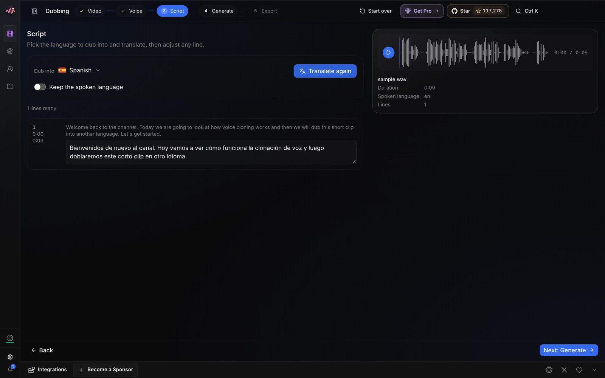
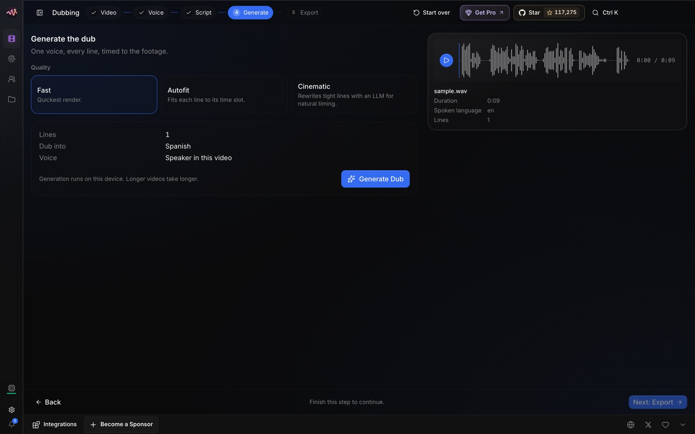

<div align="center">
  
  <h1>VoiceStudio</h1>
  <p>
    <a href="https://trendshift.io/repositories/28176?utm_source=repository-badge&amp;utm_medium=badge&amp;utm_campaign=badge-repository-28176" target="_blank" rel="noopener noreferrer"></a>
  </p>
  <p><strong>Fork of <a href="https://github.com/debpalash/VoiceStudio">debpalash/VoiceStudio</a> focused on one job: clone a voice and dub it onto a video — fully local.</strong></p>
  <p>
    <a href="https://voicestudio.sh/?utm_source=github&utm_medium=readme&utm_campaign=project">Website</a> ·
    <a href="https://github.com/debpalash/VoiceStudio/releases/latest">Download</a> ·
    <a href="#get-started">Get started</a> ·
    <a href="#documentation">Docs</a> ·
    <a href="https://discord.gg/bzQavDfVV9">Discord</a> ·
    <a href="README_CN.md">简体中文</a>
  </p>
  <p>
    <a href="https://github.com/debpalash/VoiceStudio/actions/workflows/ci.yml"></a>
    <a href="https://github.com/debpalash/VoiceStudio/releases/latest"></a>
    <a href="LICENSE"></a>
  </p>
</div>



## What this fork does

Upstream VoiceStudio is a full studio (cloning, voice design, stories, audiobooks, dictation, transcription, batch jobs, integrations…). This fork keeps the same backend and engines but narrows the **UI to a single, linear workflow**:

> **Add a video → choose one voice → translate the script → generate → export.**

- **Single speaker.** One voice is applied to every line (`voice_match: consistent`).
- **Voice from the footage or a reference clip.** Clone the speaker heard in the video (`auto:*` profile), upload / record a 5–15 s reference, or pick a saved voice.
- **No voice design.** Design, stories, audiobooks, batch, gallery, transcriptions, calls, tools, integrations and Pro are unrouted (they redirect home); their code is still in the tree.
- **Unchanged backend.** REST/MCP API, engines, models, watermarking and projects are exactly upstream's — see the [features & engine catalog](docs/feature-catalog.md) and the [API section](#api--mcp) below.

### The five steps

| Step | What you do | Behind it |
|---|---|---|
| 1 **Video** | Drop a video/audio file or paste a URL. Speech is transcribed and the language detected. | `POST /dub/upload` → `GET /dub/transcribe-stream/{job}` |
| 2 **Voice** | Pick **Speaker in this video**, **Reference clip**, or **Saved voice**. | `POST /profiles` (clone) · one `profile_id` on every segment |
| 3 **Script** | Choose the language to dub into and translate, or **keep the spoken language**. Edit any line. | `POST /dub/translate` (local Argos by default) |
| 4 **Generate** | Fast / Autofit / Cinematic quality, then render. | `POST /dub/generate/{job}` · `GET /tasks/stream/{task}` |
| 5 **Export** | Preview Original ↔ Dub, save MP4 / audio / subtitles. | `GET /dub/tracks/{job}` · `GET /dub/download/{job}` |

The footage stays pinned on the right through every step. Later steps unlock only when the previous one is complete; in-flight work (transcribing, translating, rendering) keeps you on its step.

<table>
  <tr>
    <td></td>
    <td></td>
  </tr>
  <tr><td align="center">1 · Video</td><td align="center">2 · Voice</td></tr>
  <tr>
    <td></td>
    <td></td>
  </tr>
  <tr><td align="center">3 · Script</td><td align="center">4 · Generate</td></tr>
</table>

Where it lives: `electron/src/renderer/src/features/dubflow/` (page, stepper, five step components, `dubflow-state.ts` for gating and voice assignment). Navigation is `components/app-shell/workspace-menu.tsx`; hidden routes are `hiddenRoute()` entries in `routes/index.ts`.

## Run it

### Prerequisites

- **macOS / Linux / Windows**, Node 22+, [Bun](https://bun.sh), [uv](https://docs.astral.sh/uv/) (`brew install uv`), Git.
- A GPU helps (CUDA / Apple MPS / ROCm) but CPU works. First generation downloads the TTS and Whisper models when you approve it.
- Rust/Cargo only if you build the Electron **desktop** app (native helper).

### Browser UI + API (what the screenshots use)

```bash
git clone https://github.com/raux/VoiceStudio.git
cd VoiceStudio
bun install
bun run setup:api        # uv sync + Python setup (one-time, several GB)

# Terminal 1 — FastAPI backend on :3900
bun run dev:api

# Terminal 2 — Vite web UI on :3901
bun run dev:frontend
```

Open **http://localhost:3901/** (routes use hash history, e.g. `http://localhost:3901/#/dub`). The backend is ready when `curl http://localhost:3900/health` returns `{"status":"ok",…}` — allow ~30–40 s for migrations and deferred startup.

`bun run dev:web` does both in one terminal with `concurrently`.

### Electron desktop app

```bash
bun run dev              # starts the backend and the Electron shell
```

See [electron/README.md](electron/README.md) for packaging (`bun run build`, `bun run dist`).

### Stop

`Ctrl-C` each terminal, or `bun scripts/clear-dev-ports.mjs 3900 3901`.

### Checks

```bash
bun run --cwd electron typecheck
bun run --cwd electron lint
bun run --cwd electron test          # locale checks + vitest
bun run --cwd electron build:web
```

## API & MCP

The backend is upstream's, untouched. Useful calls while the stack is running:

```bash
curl http://localhost:3900/health
curl http://localhost:3900/openapi.json | jq '.paths | keys'     # ~290 routes

# OpenAI-compatible speech / transcription
curl http://localhost:3900/v1/audio/speech -H 'Content-Type: application/json' \
  -d '{"model":"tts-1","voice":"alloy","input":"Hello from VoiceStudio.","response_format":"wav"}' -o out.wav
curl http://localhost:3900/v1/audio/transcriptions -F file=@out.wav -F model=whisper-1 -F response_format=text

# Provenance: every synthesized clip carries an AudioSeal watermark ("OM", 16 bits)
curl http://localhost:3900/watermark/detect -F file=@out.wav
```

Dub pipeline from the shell: `POST /dub/upload` (multipart `video`, `job_id`, `input_type`) → `GET /dub/transcribe-stream/{job}` (SSE) → `POST /dub/translate` → `POST /dub/generate/{job}` → `GET /dub/tracks/{job}` → `GET /dub/download/{job}`. MCP is mounted at `http://localhost:3900/mcp` with `generate_speech`, `clone_voice`, `transcribe`, `list_voices`, `check_health`. Full guides: [Local API](docs/speech-platform.md) · [MCP](docs/mcp.md).

## Upstream install (unchanged)

The one-command installer, release downloads and platform guides from upstream still apply to the backend and desktop shell; only the renderer differs on this fork's `feat/clone-dub-focused-ui` branch.

**[macOS](docs/install/macos.md) · [Windows](docs/install/windows.md) · [Linux](docs/install/linux.md) · [Docker](docs/install/docker.md)** · [Troubleshooting](docs/install/troubleshooting.md) · [Model downloads](docs/downloading-models.md)

## Documentation

| Need | Start here |
|---|---|
| Setup help | [Troubleshooting](docs/install/troubleshooting.md) · [Model downloads](docs/downloading-models.md) |
| Models & audio quality | [Engine guides](docs/engines/README.md) · [Benchmarks](docs/benchmarks.md) |
| Integrations | [Local API](docs/speech-platform.md) · [MCP](docs/mcp.md) · [Examples](examples/README.md) |
| Development | [Contributing](.github/CONTRIBUTING.md) · [Electron](electron/README.md) · [Changelog](CHANGELOG.md) |

Agent skills: `npx skills add debpalash/VoiceStudio` — choose **voicestudio** for audio workflows or **voicestudio-maintainer** for repository maintenance.

## Sponsors

<a href="https://forms.gle/2PYCvd39hbwijzX37"></a>

**Become a featured partner.** [Apply for a paid placement](https://forms.gle/2PYCvd39hbwijzX37) · [Email us](mailto:partner@voicestudio.sh)

Support development: [Ko-fi](https://ko-fi.com/debpalash) · [PayPal](https://paypal.me/palashCoder) · [Sponsorship details](SPONSORS.md)

## License & responsible use

[AGPL-3.0](LICENSE). Models have their own licenses; review them before commercial use. Clone voices only with permission. See [license details](LICENSE-NOTICE.md).
